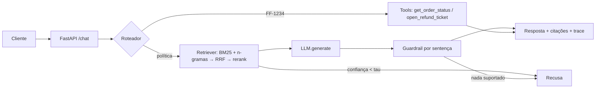

# support-agent

Agente de suporte para um app de delivery fictício (**FoodFlow**): responde sobre políticas com RAG + citações, executa ferramentas sobre pedidos (consulta de status, abertura de reembolso) e **recusa o que não está fundamentado**. O foco do repositório é o *harness de avaliação*: tudo que é afirmado aqui é medido por `make eval` e protegido por gate de CI.

## Resultados (medidos neste repositório, split `test`)
Detalhes e metodologia em [docs/EVAL.md](docs/EVAL.md) (gerado por `evals/run_eval.py`).

| Métrica | Valor | Observação |
|---|---|---|
| Recuperação, MRR (chunk) | 0.935 (hybrid+rerank) · 0.958 (BM25) | n=18, IC95% largos e sobrepostos: **não há diferença significativa entre os modos** |
| recall@3 (chunk) | 1.0 hybrid+rerank · 0.944 demais | |
| Resposta contém o fato esperado | 0.889 | 2 das 18 falham (seleção de frase) |
| Recusa de perguntas fora de escopo | 0.833 | 1 de 6 falha ("horário do metrô" ↔ "horário agendado") |
| Afirmação fabricada chega ao usuário (injeção de falha 50%) | 0.417 sem guardrail → **0.0** com guardrail | gerador com falha *simulada*, não um LLM real |
| Latência p95 (CPU, in-process) | ~1.4 ms | gerador extrativo; um LLM real domina a latência |

**O que estes números não provam.** Dataset de 50 perguntas escritas à mão, corpus de 8 documentos / 26 chunks, retrieval e gerador são substitutos offline (ver [ADR 0001](docs/adr/0001-retrieval-offline-stand-ins.md)). O resultado honesto da ablação: em corpus tão pequeno, BM25 sozinho já é forte e o reranker só melhora recall@3. Para conclusões sobre alucinação real é preciso rodar `AnthropicLLM` (ou outro) e um corpus maior.

## Arquitetura

- **Autorização nas tools:** pedido de outro cliente responde exatamente como pedido inexistente (sem vazar existência).
- **Idempotência:** mesmo (pedido, motivo) devolve o mesmo chamado.
- **Trace por requisição:** passos, tempos e confiança no corpo da resposta; `TRACE_LOG=1` emite JSON em log.

## Rodando
```bash
make install && make test     # 17 testes
make eval                     # regenera docs/EVAL.md e aplica o gate de regressão
uvicorn support_agent.api:app --reload
curl -s localhost:8000/chat -H 'content-type: application/json' \
  -d '{"message":"Em quanto tempo o reembolso via Pix cai na conta?"}'
curl -s localhost:8000/chat -H 'content-type: application/json' \
  -d '{"message":"Quero reembolso do pedido FF-1001, veio faltando um item","customer_id":"c1"}'
docker compose up --build     # mesma API em container (imagem construída e testada com curl nesta entrega)
```
Sem chave de API, sem GPU. Para usar um LLM real, instancie `SupportAgent(llm=AnthropicLLM())` (`ANTHROPIC_API_KEY`); essa classe **não foi exercitada ao vivo** nesta entrega.

## Decisões
[ADR 0001](docs/adr/0001-retrieval-offline-stand-ins.md) substitutos offline · [ADR 0002](docs/adr/0002-guardrail-groundedness.md) guardrail por sentença.

## Limitações e próximos passos
- O gerador extrativo às vezes anexa uma 2ª frase fundamentada porém fora de tópico (ex.: pergunta sobre reembolso via Pix também traz a regra de prazo do Pix para pagamento); um LLM real ou um limiar relativo entre frases resolveria.
- Trocar n-gramas por embeddings multilíngues (bge-m3) e o reranker por cross-encoder; re-rodar a ablação em corpus ≥ 1k chunks.
- Guardrail lexical não pega negação invertida → camada NLI/LLM-judge.
- Custo por conversa só é *estimado* (caracteres/4); com LLM real usar `usage` da API.
- Integração com Langfuse/OpenTelemetry (hoje: trace estruturado na resposta e em log).
- Roteamento de intenção é por regex; trocar por classificador/tool-calling nativo do LLM.
